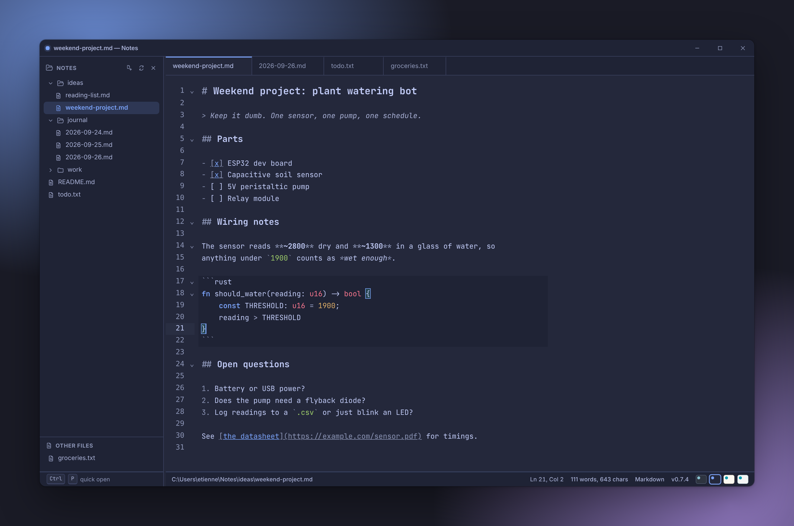
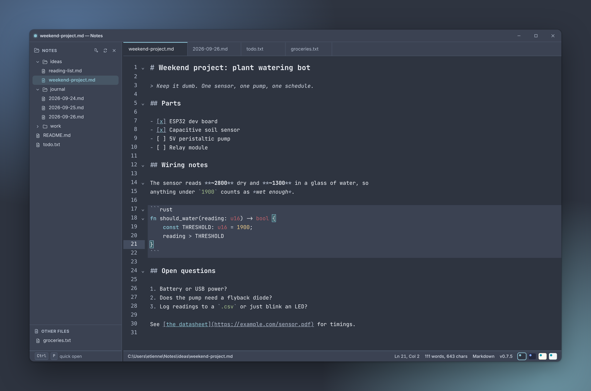
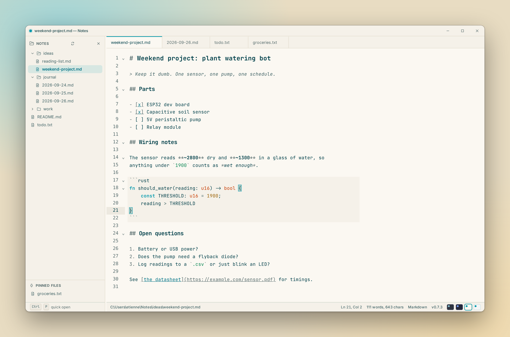
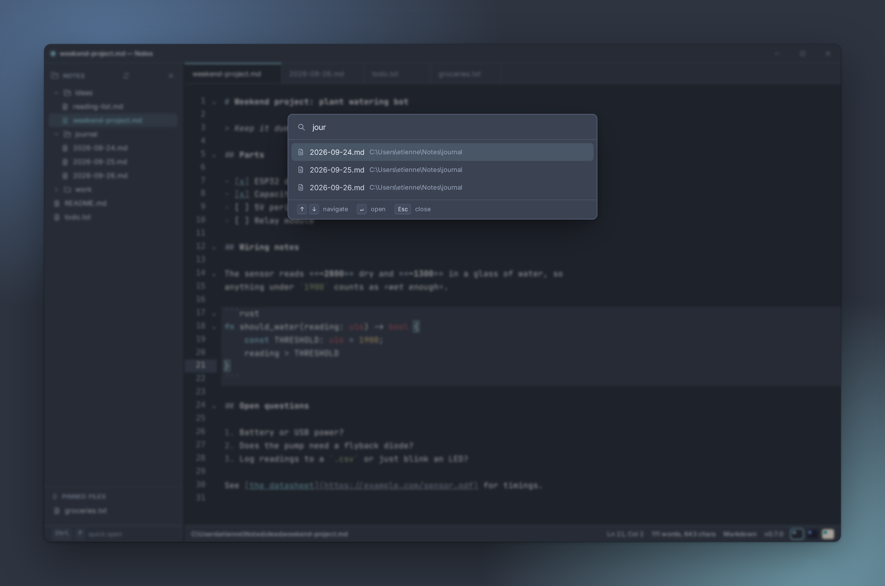

# Notes

A desktop editor for `.txt` and `.md` files that opens instantly.

It never owns your files. There's no vault, no index database and no project
to set up. Point it at a file or a folder and start typing. It sits between
Notepad++ (fast, but no real Markdown) and Obsidian or VS Code (capable, but
built around a workspace).

**[Download for Windows](https://github.com/etiennedelange/notes/releases/latest)**
· [Website](https://notes-site-ojq.pages.dev/) · macOS and Linux builds are
[on the backlog](./docs/ENHANCEMENTS.md).

## What it does

- Edits `.txt` and `.md` files in place on disk. Saves are atomic, and it
  warns you if a file changed on disk while it was open.
- `Ctrl+P` fuzzy quick-open across the open folder, pinned files and recent
  files.
- Tabs with unsaved-changes protection on close and on quit.
- An optional folder sidebar. It's a view of the folder, not a managed
  workspace.
- Markdown highlighting, including fenced code in its own language.
- Three themes you can switch while it runs: Nord, Tokyo Night and Noctis Lux.

| Nord | Noctis Lux | Quick-open |
| --- | --- | --- |
|  |  |  |

## Development

Requires [Node.js](https://nodejs.org/), [pnpm](https://pnpm.io/) (via
`corepack enable`), [Rust](https://www.rust-lang.org/tools/install) and the
[Tauri prerequisites](https://v2.tauri.app/start/prerequisites/) for your
platform. The dev container in `.devcontainer/` installs all of these.

| Command | Purpose |
| --- | --- |
| `pnpm install` | Install dependencies |
| `pnpm tauri dev` | Run the app with hot reload |
| `pnpm test` | Front-end unit tests (Vitest, via [Vite+](https://viteplus.dev)) |
| `pnpm check` | Format, lint and typecheck the front end (`vp check`) |
| `pnpm test:scripts` | Tests for the release scripts |
| `cd src-tauri && cargo test --workspace` | Rust tests, including `notes-core` |
| `pnpm tauri build` | Build installers for the current platform (needs the updater key, or `--config src-tauri/tauri.no-updater.conf.json`) |
| `pnpm release [x.y.z]` | Release (the next patch if no version): version PR, merge, tag, and the Windows build (see [`docs/RELEASING.md`](./docs/RELEASING.md)) |
| `pnpm mock:web` | Run the front end in any browser against a mock backend, no Tauri needed |
| `pnpm screenshots` | Regenerate the screenshots in `docs/screenshots/` and the site |

The marketing site lives in [`site/`](./site/) and has its own README.

The screenshots come from `scripts/screenshots/`. The script runs the front
end in headless Chromium and swaps the Rust backend for a mock that serves a
sample notes folder, so it works anywhere, not just on Windows. Run
`pnpm exec playwright install chromium` once before the first run.

`pnpm mock:web` serves the same front end and mock on the dev server
(`http://localhost:1420`, with hot reload) for working on the UI in a normal
browser. Saves go to memory and are lost on reload; native dialogs act as if
cancelled. `pnpm mock:web --update` also offers an update to the next patch
version, with the `[Unreleased]` CHANGELOG entries as its notes, for working
on the update button and dialog.

## How it works

It's a [Tauri 2](https://v2.tauri.app/) app. The window is a system webview
running a [CodeMirror 6](https://codemirror.net/) editor (`src/`). It talks to
a small Rust backend over Tauri IPC.

The Rust side is split in two. `src-tauri/core/` (`notes-core`) holds
everything that doesn't care how the UI is drawn: file access, atomic saves,
the folder walk and session persistence. `src-tauri/src/` is the thin Tauri
shell around it. Keeping the core free of Tauri means a different front end
could replace the webview later without touching the file logic. Why the
webview stayed, for now, is in [`docs/HISTORY.md`](./docs/HISTORY.md).

File access is consent-based. The backend only reads or writes paths you've
explicitly opened, or that sit under a folder you've opened. It refuses to
write anything but `.txt` and `.md` files. A strict CSP locks down the webview. Folder walks are capped
at 8,000 entries and 12 levels deep, and single files at 50 MB, so pointing it
at your home directory can't stall the app.

`tauri build` only builds for the platform it runs on. Shipped Windows
installers come from CI: `pnpm release <x.y.z>` merges a version PR and tags
it, and the tag runs `.github/workflows/release.yml`, which builds the
installer and publishes the GitHub release. Installed copies update
themselves from there. The steps, the updater and its signing key are in
[`docs/RELEASING.md`](./docs/RELEASING.md); what changed in each version is
in [`CHANGELOG.md`](./CHANGELOG.md), and past releases with their
installers are on the
[releases page](https://github.com/etiennedelange/notes/releases).

## Docs

- [`PRODUCT.md`](./PRODUCT.md): who it's for, and what it deliberately leaves
  out
- [`docs/HISTORY.md`](./docs/HISTORY.md): dated log of decisions and the
  reasons behind them
- [`docs/ENHANCEMENTS.md`](./docs/ENHANCEMENTS.md): deferred ideas
- [`docs/RELEASING.md`](./docs/RELEASING.md): branches, releases and the
  in-app updater

## License

[MIT](./LICENSE) © Etienne de Lange
